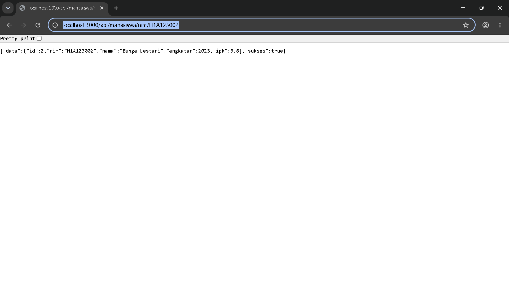
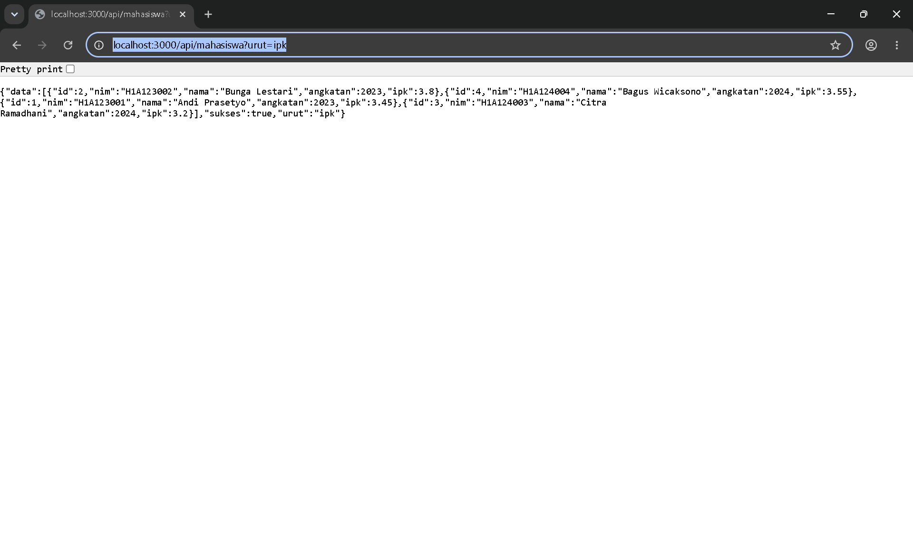
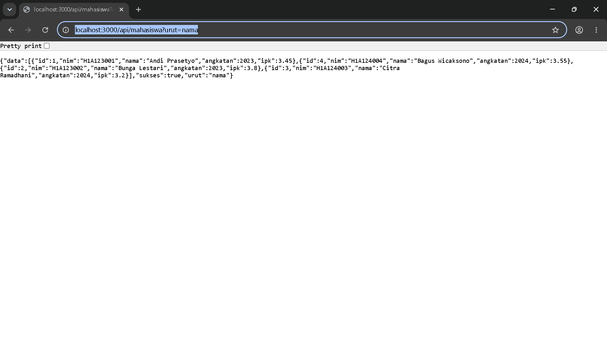
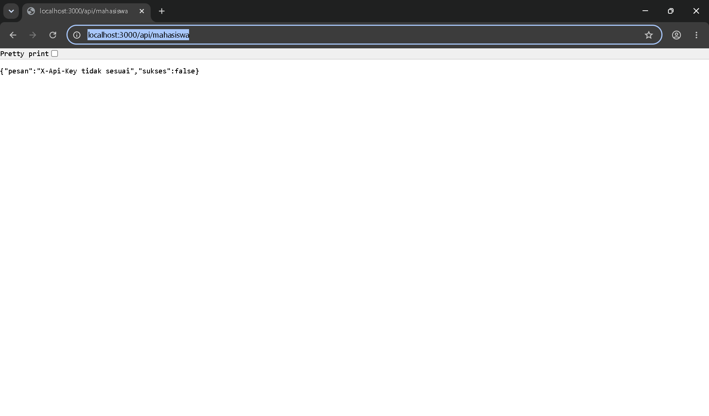
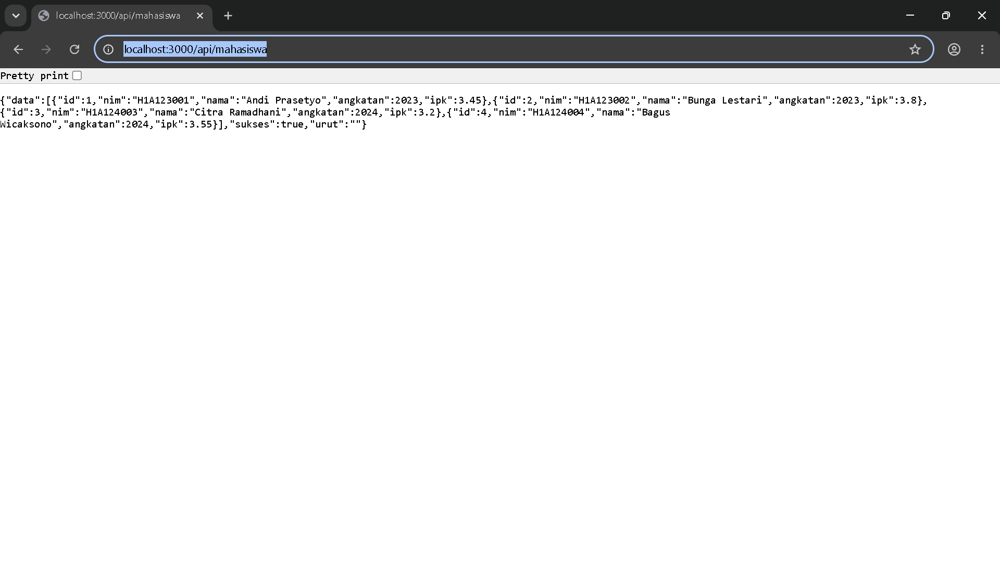

# E. Tugas Praktikum

### 1. Tambahkan endpoint GET /api/mahasiswa/nim/:nim yang mencari data berdasarkan NIM.

  >Saya menambahkan method `CariBerdasarkanNim` pada handler. Method ini membaca parameter `nim` dari URL, lalu mencocokkannya dengan isi slice `model.Daftar` memakai perulangan for biasa. Kalau NIM cocok, data mahasiswa dikembalikan sebagai JSON. Kalau tidak ada yang cocok, handler mengembalikan galat 404 melalui `fiber.NewError(fiber.StatusNotFound, ...)`.
  >
  >File yang digunakan:
  >
  >- `latihan-fiber-api/internal/handler/mahasiswa_handler.go`
  >- `latihan-fiber-api/internal/router/router.go`

  >**Yang perlu di-screenshot:**
  >
  >- **Kode**: method `CariBerdasarkanNim` di `internal/handler/mahasiswa_handler.go` (mulai baris 39) beserta rutenya `mahasiswa.Get("/nim/:nim", handler.CariBerdasarkanNim)` di `internal/router/router.go` (baris 23).
  >- **Tampilan**: halaman browser `http://localhost:3000/api/mahasiswa/nim/H1A123002` (berikut URL di address bar), hasilnya sudah saya lampirkan di bawah.



  >NIM yang tidak ada pada data menghasilkan status 404:

```text
HTTP/1.1 404 Not Found
{"pesan":"Mahasiswa tidak ditemukan","sukses":false}
```

### 2. Tambahkan parameter kueri urut bernilai nama atau ipk pada endpoint daftar mahasiswa.

  >Handler `DaftarMahasiswa` membaca parameter `urut` memakai `c.Query("urut", "")`. Isi slice `model.Daftar` disalin dulu ke slice baru memakai `copy`, supaya urutan asli data tidak berubah. Sortir dilakukan dengan `sort.SliceStable`: `nama` diurutkan dari A ke Z, sedangkan `ipk` diurutkan dari yang terbesar. Nilai `urut` selain `nama` dan `ipk` ditolak dengan status 400.
  >
  >File yang digunakan:
  >
  >- `latihan-fiber-api/internal/handler/mahasiswa_handler.go` (method `DaftarMahasiswa`, mulai baris 10)
  >- `latihan-fiber-api/internal/router/router.go` (rute `mahasiswa.Get("", handler.DaftarMahasiswa)`, baris 22)

  >**Yang perlu di-screenshot:**
  >
  >- **Kode**: method `DaftarMahasiswa` di `internal/handler/mahasiswa_handler.go`, khususnya bagian if yang membaca parameter `urut` dan pemakaian `sort.SliceStable`.
  >- **Tampilan**: dua halaman browser, yaitu `http://localhost:3000/api/mahasiswa?urut=ipk` dan `http://localhost:3000/api/mahasiswa?urut=nama`, sudah saya lampirkan di bawah.





  >Kalau nilai `urut` bukan `nama` atau `ipk`, permintaan ditolak:

```text
HTTP/1.1 400 Bad Request
{"pesan":"Parameter urut harus bernilai nama atau ipk","sukses":false}
```

### 3. Buat middleware KunciApi yang memeriksa header X-Api-Key dan menolak permintaan dengan status 401 apabila nilainya tidak sesuai dengan nilai pada berkas .env.

  >Middleware `KunciApi` dibuat sebagai fungsi pabrik yang menerima nilai kunci, lalu mengembalikan `fiber.Handler`. Di dalamnya, header `X-Api-Key` dibandingkan dengan nilai kunci. Bila header kosong atau nilainya tidak sama, permintaan dibalas dengan `fiber.NewError(fiber.StatusUnauthorized, ...)`. Nilai kunci dibaca dari berkas `.env` lewat `internal/config/config.go` memakai package `godotenv`.
  >
  >Middleware dipasang pada grup `/mahasiswa` dengan `mahasiswa.Use(middleware.KunciApi(kunciAPI))`, sehingga seluruh endpoint mahasiswa wajib menyertakan kunci. Rute `/api/status` tetap terbuka untuk memastikan bahwa yang menolak memang middleware ini.
  >
  >Isi berkas `.env`:

```text
APP_NAME=Pemweb2 Fiber API
APP_PORT=3000
APP_ENV=local
API_KEY=pemweb2-kunci
```

  >File yang digunakan:
  >
  >- `latihan-fiber-api/internal/middleware/kunci_api.go`
  >- `latihan-fiber-api/internal/config/config.go`
  >- `latihan-fiber-api/.env`

  >**Yang perlu di-screenshot:**
  >
  >- **Kode**: isi `internal/middleware/kunci_api.go` (hanya sekitar 12 baris), baris `KunciAPI: ambil("API_KEY", "")` di `internal/config/config.go` (baris 23), baris `mahasiswa.Use(middleware.KunciApi(kunciAPI))` di `internal/router/router.go` (baris 20), dan berkas `.env` (nilai `API_KEY` boleh disamarkan).
  >- **Tampilan**: dua halaman browser, yaitu `http://localhost:3000/api/mahasiswa` tanpa header (ditolak) dan dengan header yang benar (diterima), sudah saya lampirkan di bawah.





  >Karena browser biasa tidak bisa menambahkan header sendiri, status responsnya saya periksa memakai curl:

```text
curl -i http://localhost:3000/api/mahasiswa
HTTP/1.1 401 Unauthorized
{"pesan":"X-Api-Key tidak sesuai","sukses":false}

curl -i -H "X-Api-Key: pemweb2-kunci" http://localhost:3000/api/mahasiswa
HTTP/1.1 200 OK
{"data":[{"id":1,"nim":"H1A123001","nama":"Andi Prasetyo","angkatan":2023,"ipk":3.45}, ...],"sukses":true,"urut":""}
```

### 4. Buat tabel perbandingan antara mekanisme middleware Laravel dan middleware Fiber berdasarkan pengalaman pada Modul 2, Modul 5, dan modul ini.

Berikut perbandingan middleware Laravel (Modul 2 dan Modul 5) dengan middleware Fiber v3 (Modul 6) berdasarkan pengalaman praktikum:

<table>
  <thead>
    <tr>
      <th>Aspek</th>
      <th>Middleware Laravel</th>
      <th>Middleware Fiber</th>
    </tr>
  </thead>
  <tbody>
    <tr>
      <td><strong>Bentuk penulisan</strong></td>
      <td>Class dengan method<br><code>handle(Request $request, Closure $next)</code></td>
      <td>Fungsi biasa yang mengembalikan<br><code>fiber.Handler</code></td>
    </tr>
    <tr>
      <td><strong>Contoh pada praktikum</strong></td>
      <td>Modul 2: middleware bawaan Laravel<br>pada rute web.<br>Modul 5: middleware kustom<br><code>PeranAdmin</code> + middleware Sanctum</td>
      <td>Modul 6: middleware kustom<br><code>WaktuProses</code> dan <code>KunciApi</code>,<br>serta middleware bawaan<br><code>logger</code>, <code>recover</code>, <code>requestid</code></td>
    </tr>
    <tr>
      <td><strong>Cara mendaftarkan</strong></td>
      <td>Didaftarkan di <code>bootstrap/app.php</code>,<br>kemudian dipakai pada rute lewat<br><code>-&gt;middleware('...')</code> atau pada controller</td>
      <td>Didaftarkan langsung di code:<br><code>app.Use(...)</code> untuk semua rute,<br>atau <code>grup.Use(...)</code> untuk grup tertentu</td>
    </tr>
    <tr>
      <td><strong>Nilai tambahan</strong><br>(misalnya kunci API)</td>
      <td>Nilai dikirim lewat constructor class,<br>lalu dibaca dari <code>.env</code> dengan <code>env()</code></td>
      <td>Nilai dikirim sebagai argumen fungsi pabrik,<br>contohnya <code>KunciApi(kunci)</code>,<br>lalu dibaca dari <code>.env</code> dengan <code>godotenv.Load()</code></td>
    </tr>
    <tr>
      <td><strong>Melanjutkan ke handler</strong></td>
      <td><code>return $next($request);</code></td>
      <td><code>return c.Next()</code></td>
    </tr>
    <tr>
      <td><strong>Menolak permintaan</strong></td>
      <td><code>abort(403)</code> atau<br><code>response()-&gt;json([...], 401)</code></td>
      <td><code>return fiber.NewError(401, "pesan")</code><br>yang diteruskan ke error handler global</td>
    </tr>
    <tr>
      <td><strong>Kode sebelum dan sesudah lanjut</strong></td>
      <td>Kode sebelum <code>$next</code> jalan saat request masuk,<br>sesudahnya jalan saat respons dikirim</td>
      <td>Sama persis: kode sebelum <code>c.Next()</code><br>untuk request, sesudahnya untuk respons</td>
    </tr>
    <tr>
      <td><strong>Galat pada handler</strong></td>
      <td>Tidak ada nilai kembalian wajib,<br>kesalahan dibuang lewat exception</td>
      <td>Handler wajib mengembalikan <code>error</code>,<br>nilainya dipakai oleh rantai middleware</td>
    </tr>
    <tr>
      <td><strong>Penanganan galat global</strong></td>
      <td>Exception handler pada Laravel,<br>misalnya <code>app/Exceptions/Handler.php</code></td>
      <td><code>ErrorHandler</code> pada <code>fiber.Config</code>,<br>pada praktikum ini method <code>penanganGalat</code></td>
    </tr>
  </tbody>
</table>

  >Kesimpulannya: konsepnya sama, yaitu middleware adalah lapisan yang membungkus handler dan harus memutuskan apakah melanjutkan atau menolak. Yang berbeda hanya bentuk sintaksnya. Laravel menutupnya dalam class yang menerima <code>Request</code> dan <code>Closure</code>, sedangkan Fiber memakai fungsi biasa yang mengembalikan <code>fiber.Handler</code> dan meneruskan <code>c.Next()</code>. Selain itu, pendaftaran middleware Laravel dilakukan terpisah dari rute, sedangkan Fiber mendaftarkan middleware langsung bersama rute sehingga urutannya terlihat jelas dalam satu berkas router.

# F. Pertanyaan Pembahasan

### 1. Mengapa handler Fiber selalu mengembalikan nilai bertipe error?

  >Karena bahasa Go tidak memiliki mekanisme exception. Setiap kemungkinan kegagalan harus dinyatakan secara eksplisit melalui nilai kembalian. Di sisi lain, handler Fiber adalah bagian dari rantai pemrosesan permintaan, sehingga nilai `error` tersebut dipakai Fiber untuk menentukan langkah berikutnya.
  >
  >Bila handler mengembalikan `nil`, Fiber menganggap handler selesai dan lanjut ke middleware berikutnya atau mengirim respons. Bila nilainya bukan `nil`, Fiber menghentikan rantai dan meneruskan galat itu ke `ErrorHandler` global, yaitu method `penanganGalat` pada praktikum ini, yang mengubahnya menjadi respons JSON. Dengan begitu, kegagalan tidak pernah hilang begitu saja dan penanganannya terpusat.

### 2. Jelaskan fungsi middleware recover dan akibat yang timbul apabila middleware tersebut tidak dipasang.

  >Middleware `recover` menangkap `panic` yang terjadi di dalam handler, lalu mencatatnya dan mengembalikan respons dengan status 500. Dengan demikian proses server tetap hidup dan hanya permintaan yang bermasalah itu saja yang menerima kesalahan.
  >
  >Kalau middleware ini tidak dipasang, satu `panic` pada satu handler akan langsung menghentikan seluruh proses aplikasi. Semua permintaan berikutnya tidak akan terlayani karena prosesnya sudah mati, klien yang menunggu tidak menerima respons apa pun, dan aplikasi baru bisa berjalan lagi setelah dijalankan ulang. Karena itu `recover` dipasang paling awal bersama `logger` dan `requestid` pada `cmd/api/main.go`.

### 3. Apa maksud folder internal pada konvensi proyek Go?

  >Folder `internal` menandai bahwa paket di dalamnya hanya boleh diimpor oleh modul proyek itu sendiri. Compiler Go menolak impor paket `internal` dari modul lain, sehingga isi folder ini menjadi detail implementasi yang tidak bisa dipakai proyek luar.
  >
  >Pada proyek ini, isi `internal` adalah `config`, `handler`, `middleware`, `model`, dan `router`, semuanya hanya dipakai oleh `cmd/api/main.go`. Konvensi ini membuat batas antara kode publik dan kode internal jelas, sehingga isi folder bisa diubah atau diuji ulang tanpa harus memikirkan efeknya ke pihak lain.

### 4. Bandingkan ukuran dan cara distribusi hasil build Go dengan hasil deployment aplikasi Laravel.

  >Hasil build Go berupa satu berkas binary. Pada praktikum ini binary dibuat dengan `go build -o bin/api ./cmd/api` dan berukuran beberapa belas MB. Seluruh dependensi dan runtime-nya sudah termasuk di dalam binary, jadi file itu cukup diunggah ke server lalu dijalankan langsung tanpa perlu memasang toolchain Go.
  >
  >Hasil deployment Laravel berupa source code beserta folder `vendor` dan aset frontend yang besarnya puluhan MB, dan tetap membutuhkan runtime PHP serta web server seperti Apache, Nginx, atau `php artisan serve`. Selain itu masih perlu berkas `.env`, pengaturan permission folder `storage` dan `bootstrap/cache`, serta `composer install` jika dependensi berubah.
  >
  >Jadi distribusi Go jauh lebih sederhana karena cukup satu file dan satu proses, sedangkan Laravel membutuhkan penyalinan banyak berkas dan konfigurasi server. Sebagai gantinya, Laravel menyediakan banyak fitur bawaan yang pada Go harus dirakit sendiri.

## Menjalankan Project dan Mengambil Screenshot

Jalankan perintah berikut dari folder `latihan-fiber-api`:

```powershell
go mod tidy
go run ./cmd/api
```

Server berjalan di port `3000`. Uji cepat memakai curl:

```text
curl -i http://localhost:3000/api/status
curl -i http://localhost:3000/api/mahasiswa
curl -i -H "X-Api-Key: pemweb2-kunci" http://localhost:3000/api/mahasiswa
curl -i -H "X-Api-Key: pemweb2-kunci" "http://localhost:3000/api/mahasiswa?urut=ipk"
curl -i -H "X-Api-Key: pemweb2-kunci" "http://localhost:3000/api/mahasiswa?urut=nama"
curl -i -H "X-Api-Key: pemweb2-kunci" http://localhost:3000/api/mahasiswa/nim/H1A123002
```

Gambar tampilan pada laporan ini tersedia bersama README ini:

- `01-cari-nim.png`
- `02-urut-ipk.png`
- `03-urut-nama.png`
- `04-tanpa-api-key-401.png`
- `05-dengan-api-key-200.png`

Bagian yang masih perlu di-screenshot manual adalah bagian kodenya, yaitu `internal/handler/mahasiswa_handler.go`, `internal/middleware/kunci_api.go`, `internal/router/router.go`, `internal/config/config.go`, dan berkas `.env` sesuai penanda pada tiap butir di atas.