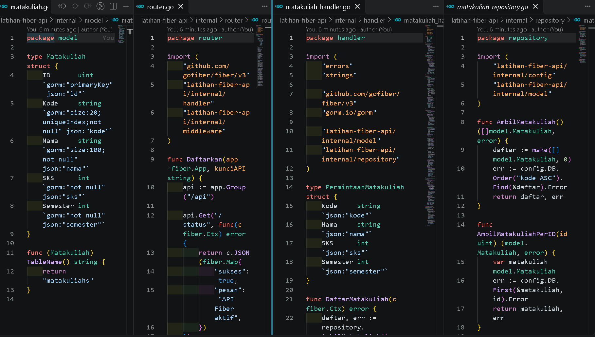
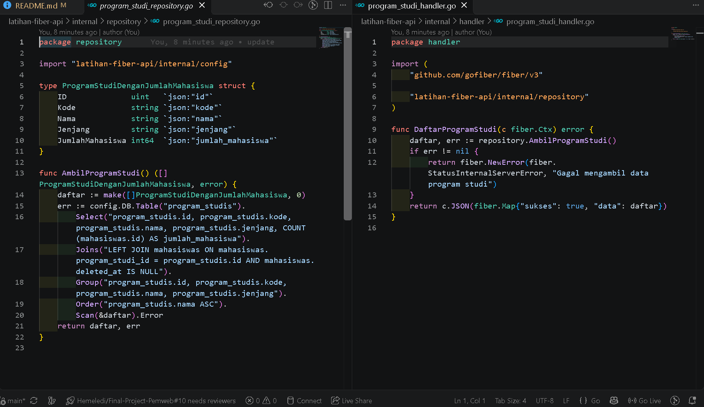
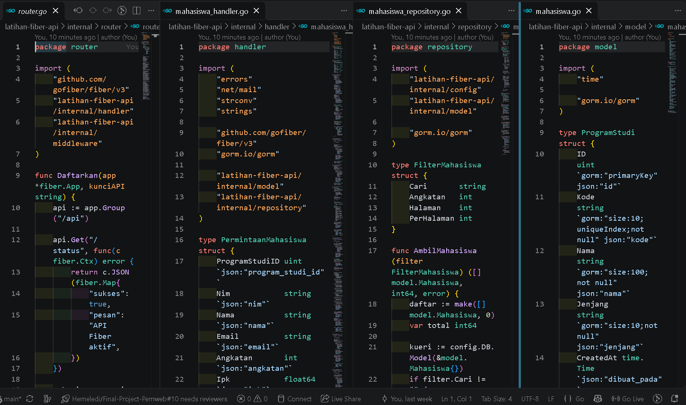

# E. Tugas Praktikum
 
 
### 1. Tambahkan resource matakuliah dengan CRUD lengkap mengikuti pola repository dan handler yang sama.
 
  >Resource mata kuliah telah dibuat dengan model, repository, handler, dan route terpisah. Endpoint yang tersedia adalah `GET /api/matakuliah`, `GET /api/matakuliah/:id`, `POST /api/matakuliah`, `PUT /api/matakuliah/:id`, dan `DELETE /api/matakuliah/:id`.

  >Model: [`matakuliah.go`](../latihan-fiber-api/internal/model/matakuliah.go)  
  >Repository: [`matakuliah_repository.go`](../latihan-fiber-api/internal/repository/matakuliah_repository.go)  
  >Handler: [`matakuliah_handler.go`](../latihan-fiber-api/internal/handler/matakuliah_handler.go)  
  >Route: [`router.go`](../latihan-fiber-api/internal/router/router.go)
 

 
### 2. Tambahkan endpoint GET /api/program-studi beserta jumlah mahasiswa pada setiap program studi.
 
  >Endpoint `GET /api/program-studi` menampilkan data setiap program studi beserta jumlah mahasiswanya. Perhitungan menggunakan `LEFT JOIN` dan tidak menyertakan mahasiswa yang sudah di-soft-delete.

  >Repository: [`program_studi_repository.go`](../latihan-fiber-api/internal/repository/program_studi_repository.go)  
  >Handler: [`program_studi_handler.go`](../latihan-fiber-api/internal/handler/program_studi_handler.go)
 

 
### 3. Terapkan soft delete pada model Mahasiswa menggunakan gorm.DeletedAt, lalu tambahkan endpoint pemulihan data.
 
  >Model mahasiswa menggunakan `gorm.DeletedAt`. Data yang dihapus dapat dipulihkan melalui `POST /api/mahasiswa/:id/pulihkan`. Endpoint mahasiswa memerlukan header `X-Api-Key`. Setelah soft delete, detail mahasiswa mengembalikan status `404`; setelah dipulihkan, data dapat diakses kembali.

  >Model: [`mahasiswa.go`](../latihan-fiber-api/internal/model/mahasiswa.go)  
  >Repository: [`mahasiswa_repository.go`](../latihan-fiber-api/internal/repository/mahasiswa_repository.go)  
  >Handler: [`mahasiswa_handler.go`](../latihan-fiber-api/internal/handler/mahasiswa_handler.go)  
  >Route: [`router.go`](../latihan-fiber-api/internal/router/router.go)
 

 
### 4. Bandingkan jumlah baris kode yang dibutuhkan untuk membangun endpoint CRUD pada Laravel dan pada Fiber, kemudian analisis penyebab perbedaannya.

  >Jumlah LOC menghitung baris kode yang tidak kosong dan bukan komentar. Cakupan perhitungan meliputi model, handler/controller, repository Fiber, validasi, resource, helper bersama, dan deklarasi route CRUD. Konfigurasi aplikasi serta migrasi awal tidak dihitung.

  >| Framework | Rincian berkas | Total LOC |
  >|---|---|---:|
  >| Laravel | Controller (76) + Store Request (27) + Update Request (26) + Resource (17) + Model (16) + route (1) | **163** |
  >| Fiber + GORM | Handler (135) + Repository (24) + Model (11) + helper bersama (26) + routes (6) | **202** |

  >Fiber membutuhkan 39 LOC lebih banyak (sekitar 23,9%) pada cakupan ini. Laravel mendaftarkan CRUD dengan satu `apiResource`, menggunakan Eloquent untuk operasi basis data, serta memisahkan validasi dan serialisasi ke Form Request dan Resource. Fiber mendaftarkan setiap route secara eksplisit, memisahkan handler dari repository, dan menangani validasi serta status error di kode aplikasi. Angka ini khusus untuk implementasi pada repositori ini; controller Laravel yang dihitung juga memiliki filter, pengurutan, dan pagination tambahan.

 
# F. Pertanyaan Pembahasan
 

 
### 1. Mengapa field Aktif pada DTO menggunakan pointer sedangkan field lain tidak?

  > Nilai `bool` biasa di Go bernilai `false` jika field tidak dikirim, sehingga tidak dapat membedakan field yang tidak diberikan dari permintaan untuk mengubah status menjadi `false`. Pointer `*bool` membedakan keduanya: `nil` berarti field tidak dikirim, sedangkan pointer ke `false` berarti mahasiswa sengaja dinonaktifkan. Pada DTO pembaruan, field lain juga menggunakan pointer agar nilai nol seperti IPK `0` dapat dibedakan dari field yang tidak dikirim.

### 2. Jelaskan perbedaan Save, Update, dan Updates pada GORM.

  > `Save` menyimpan seluruh field, termasuk nilai nol. Jika model memiliki primary key, GORM mencoba memperbarui baris dan dapat menjalankan `Create` sebagai fallback bila tidak ada baris yang diperbarui. `Update` mengubah satu kolom tertentu, sedangkan `Updates` mengubah beberapa kolom. `Updates` dengan struct secara default melewati nilai nol, sementara `Updates` dengan map memperbarui semua key yang diberikan, termasuk nilai `false`, `0`, atau string kosong.

### 3. Apa risiko penggunaan AutoMigrate pada lingkungan produksi?

  > `AutoMigrate` dapat membuat tabel dan kolom yang belum ada serta menyesuaikan beberapa perubahan tipe, tetapi perubahan schema saat aplikasi berjalan dapat menyebabkan perubahan yang tidak ditinjau, lock atau downtime pada tabel besar, dan masalah kompatibilitas saat beberapa versi aplikasi berjalan bersamaan. `AutoMigrate` juga tidak menghapus kolom yang sudah tidak digunakan. Karena itu, produksi sebaiknya menggunakan migrasi eksplisit yang terversi, diuji, ditinjau, dan dijalankan terpisah dari proses start aplikasi.

### 4. Bandingkan mekanisme eager loading pada GORM dengan with() pada Eloquent.

  > `Preload("ProgramStudi")` pada GORM dan `with('programStudi')` pada Eloquent sama-sama mengambil relasi secara eager agar aplikasi tidak menjalankan query relasi berulang kali (N+1). Keduanya umumnya menjalankan query terpisah untuk data utama dan relasinya, lalu memasangkan hasilnya. GORM juga menyediakan join preload untuk relasi tertentu, sementara Eloquent mendukung eager loading relasi bertingkat dan pembatasan relasi melalui `with()`.
