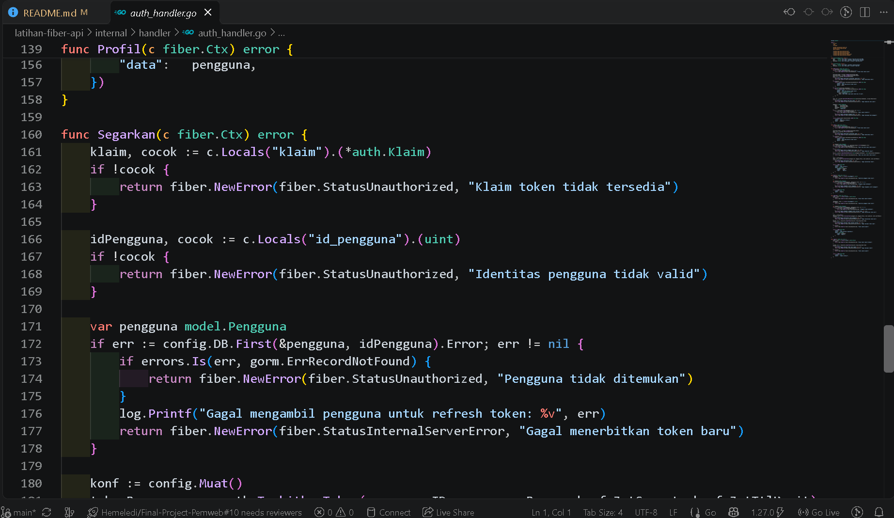
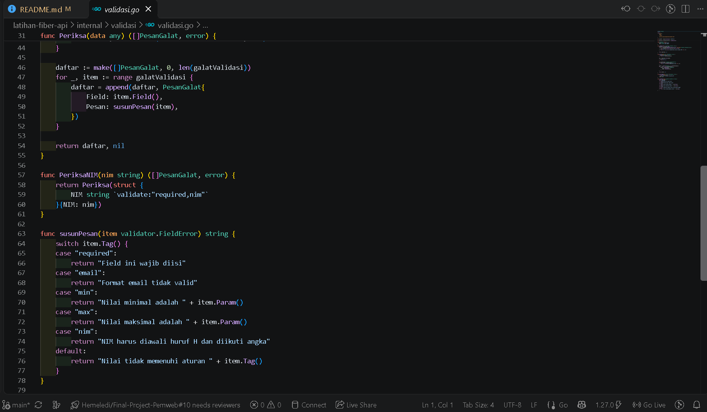

# E. Tugas Praktikum

### 1. Tambahkan endpoint `POST /api/auth/segarkan` yang menerbitkan token baru berdasarkan token yang masih berlaku.

  >Endpoint refresh hanya menerima JWT yang masih berlaku. Respons berisi token baru; token lama langsung dimasukkan ke daftar hitam agar tidak dapat digunakan kembali.
  >
  >File yang digunakan: [`auth_handler.go`](../latihan-fiber-api/internal/handler/auth_handler.go) (`Segarkan`), [`router.go`](../latihan-fiber-api/internal/router/router.go), [`token.go`](../latihan-fiber-api/internal/auth/token.go), dan [`autentikasi.go`](../latihan-fiber-api/internal/middleware/autentikasi.go).
  >
  >Screenshot kode: buka `Segarkan` di `auth_handler.go` dan route `POST /auth/segarkan` di `router.go`. Screenshot Postman: kirim `POST /api/auth/segarkan` dengan header `Authorization` berisi skema `Bearer` dan token yang masih berlaku. Simpan sebagai `01-segarkan-kode.png` dan `02-segarkan-berhasil.png`. Ambil juga screenshot respons `401` saat token lama dipakai kembali sebagai `03-token-lama-setelah-refresh.png`. Samarkan seluruh nilai token.




### 2. Tambahkan aturan validasi kustom untuk memastikan NIM diawali huruf H diikuti angka.

  >Aturan validator kustom `nim` menerima format `H` diikuti satu atau lebih angka, misalnya `H12345678`. Aturan diterapkan saat membuat maupun memperbarui data mahasiswa. NIM yang tidak sesuai menghasilkan status `400`.
  >
  >File yang digunakan: [`validasi.go`](../latihan-fiber-api/internal/validasi/validasi.go) dan [`mahasiswa_handler.go`](../latihan-fiber-api/internal/handler/mahasiswa_handler.go).
  >
  >Screenshot kode: tampilkan pendaftaran tag `nim` dan pemanggilan `PeriksaNIM`. Screenshot hasil API: uji satu NIM valid dan satu NIM tidak valid pada `POST /api/mahasiswa` (sertakan `X-Api-Key` tanpa memperlihatkan nilainya). Simpan sebagai `04-validasi-nim-kode.png` dan `05-validasi-nim-api.png`.




### 3. Buat tabel daftar hitam token sederhana agar endpoint logout dapat mencabut token sebelum kedaluwarsa.

  >Tabel `token_blacklists` menyimpan ID unik token (JTI) dan waktu kedaluwarsanya. `POST /api/auth/logout` memasukkan token aktif ke tabel tersebut; middleware memeriksa daftar hitam pada setiap endpoint autentikasi. Token yang dicabut ditolak dengan status `401`. Baris yang sudah kedaluwarsa dibersihkan saat token dicabut.
  >
  >File yang digunakan: [`pengguna.go`](../latihan-fiber-api/internal/model/pengguna.go), [`migrasi.go`](../latihan-fiber-api/internal/config/migrasi.go), [`token_blacklist_repository.go`](../latihan-fiber-api/internal/repository/token_blacklist_repository.go), [`auth_handler.go`](../latihan-fiber-api/internal/handler/auth_handler.go), dan [`autentikasi.go`](../latihan-fiber-api/internal/middleware/autentikasi.go).
  >
  >Screenshot kode: tampilkan model tabel, fungsi `CabutToken`, middleware, dan handler `Logout`. Screenshot hasil: ambil respons logout `200`, baris JTI pada tabel `token_blacklists` melalui klien basis data, lalu respons `401` ketika token yang sama dipakai untuk `GET /api/auth/profil`. Simpan sebagai `06-blacklist-kode.png`, `07-logout-berhasil.png`, `08-token-blacklist-di-database.png`, dan `09-token-ditolak-setelah-logout.png`. Samarkan token dan kredensial.


### 4. Bandingkan implementasi autentikasi Modul 5 dan Modul 8 dari jumlah kode, kemudahan, dan fleksibilitas.

  >Penghitungan LOC berikut menggunakan baris kode produksi yang tidak kosong dan bukan komentar. Cakupan Laravel mencakup controller autentikasi, model pengguna, middleware peran admin, migration kolom peran/waktu login, route autentikasi, dan pendaftaran middleware. Cakupan Fiber mencakup handler autentikasi, utilitas JWT, middleware autentikasi, repository blacklist, model pengguna/blacklist, route autentikasi, konfigurasi JWT, migration, dan pemeriksaan konfigurasi saat aplikasi dimulai. Tes, dependensi, validasi NIM, dan kode route yang tidak terkait autentikasi tidak dihitung.
  >
  >| Modul | Implementasi | Rincian LOC | Total |
  >|---|---|---|---:|
  >| 5 | Laravel + Sanctum | Controller 119 + model 21 + middleware 18 + migration 20 + route 8 + pendaftaran middleware 2 | **188** |
  >| 8 | Fiber + JWT | Handler 198 + utilitas token 80 + middleware 39 + repository blacklist 29 + model 21 + route 8 + konfigurasi JWT 9 + migration 2 + pemeriksaan konfigurasi 4 | **390** |
  >
  >Pada cakupan tersebut, implementasi Fiber membutuhkan 202 LOC lebih banyak. Angka ini merupakan pengukuran berkas dan bagian kode autentikasi pada repositori ini, bukan ukuran universal; fitur kedua modul juga tidak sepenuhnya sama. Laravel lebih ringkas karena Sanctum, validasi, hashing, dan middleware disediakan framework. Fiber memberi kendali eksplisit atas klaim serta proses tanda tangan dan verifikasi JWT, tetapi membutuhkan lebih banyak kode untuk middleware dan pencabutan token. Sanctum memudahkan pencabutan dengan menghapus token tersimpan; JWT lebih fleksibel untuk membawa klaim dan digunakan lintas layanan, tetapi logout memerlukan blacklist dan pemeriksaan tambahan.
  >
  >Untuk screenshot bukti analisis, tampilkan tabel dan uraian ini di `README.md` Tugas-8 lalu simpan sebagai `10-perbandingan-modul5-modul8.png`.


# F. Pertanyaan Pembahasan

### 1. Mengapa bcrypt lebih sesuai untuk kata sandi dibandingkan fungsi hash cepat seperti SHA-256?

  >bcrypt dirancang untuk hashing kata sandi dan sengaja dibuat lambat. Faktor biayanya dapat dinaikkan sehingga tebakan kata sandi secara massal menjadi semakin mahal. bcrypt juga menggunakan salt sehingga kata sandi yang sama tidak menghasilkan hash yang sama. SHA-256 sangat cepat dan dirancang sebagai fungsi hash umum; kecepatan itu memudahkan penyerang mencoba banyak tebakan per detik jika hash kata sandi bocor.

### 2. Apa konsekuensi apabila nilai `JWT_SECRET` bocor?

  >Pihak yang memperoleh `JWT_SECRET` dapat membuat token bertanda tangan yang terlihat sah, termasuk mengaku sebagai pengguna lain atau memalsukan klaim peran. Secret harus kuat, acak, dan disimpan di environment, bukan di repositori. Jika bocor, secret harus segera dirotasi; rotasi akan membuat token lama yang ditandatangani dengan secret sebelumnya tidak lagi dapat diverifikasi.

### 3. Mengapa penerapan logout pada JWT memerlukan usaha tambahan dibandingkan token tersimpan?

  >JWT umumnya diverifikasi dari tanda tangan dan masa berlaku tanpa mencari token ke basis data. Karena itu, server tidak memiliki catatan untuk langsung menghapus sebuah token saat logout; token yang sudah diterbitkan tetap berlaku sampai `exp`. Implementasi ini menambahkan tabel blacklist berisi JTI dan masa kedaluwarsa, lalu middleware memeriksanya sebelum menerima token. Token tersimpan seperti Sanctum lebih mudah dicabut karena baris tokennya dapat langsung dihapus.

### 4. Jelaskan alasan pesan login gagal sebaiknya tidak menyebutkan apakah email atau kata sandi yang salah.

  >Pesan umum seperti “Email atau kata sandi tidak sesuai” mencegah enumerasi akun. Jika respons menyatakan email tidak terdaftar, penyerang dapat mengumpulkan alamat yang memiliki akun dan menargetkannya dengan brute force atau phishing. Respons yang seragam untuk kedua kondisi mengurangi informasi yang dibocorkan kepada pihak yang mencoba login.

## Menjalankan Project dan Mengambil Screenshot

Atur `JWT_SECRET` dan `JWT_TTL_MENIT` pada berkas `.env` di folder `latihan-fiber-api`. Gunakan secret acak minimal 32 byte dan jangan tampilkan nilainya pada screenshot. Pastikan MySQL berjalan dan database yang dikonfigurasi dapat diakses, lalu jalankan API dari folder tersebut:

```powershell
go run ./cmd/api
```

Registrasikan pengguna melalui `POST /api/auth/registrasi`, lalu login melalui `POST /api/auth/login` untuk memperoleh token pengujian. Pada request mahasiswa, sertakan `X-Api-Key` dari konfigurasi lokal. Simpan screenshot di folder `Tugas-8` dengan nama yang dicantumkan pada setiap tugas; samarkan token, secret, API key, dan kata sandi sebelum menyimpan atau membagikannya.