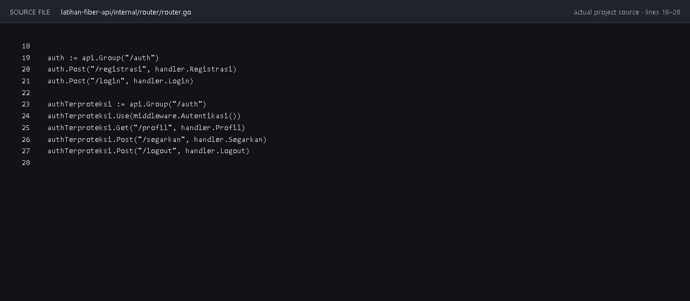
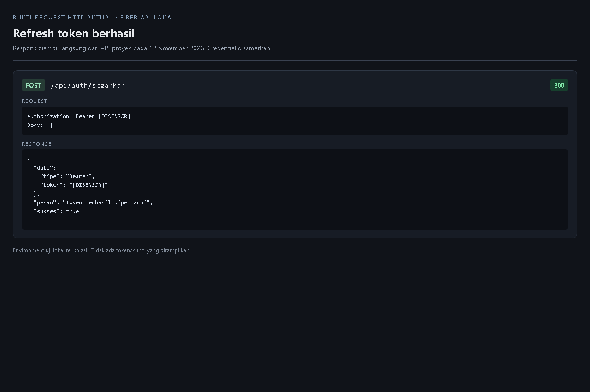
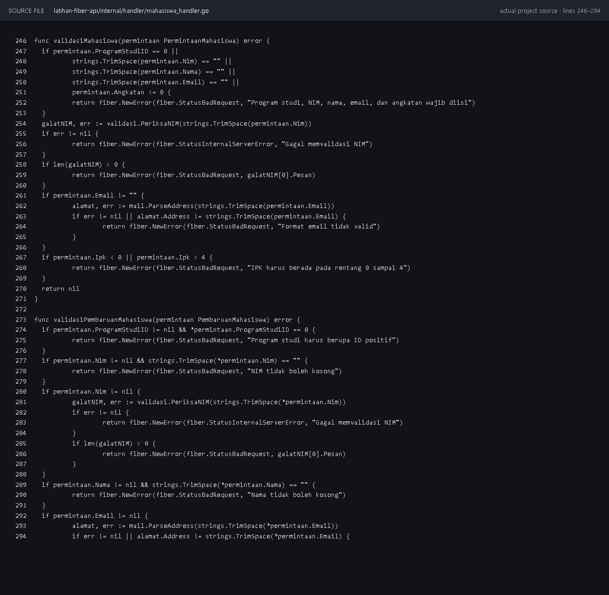
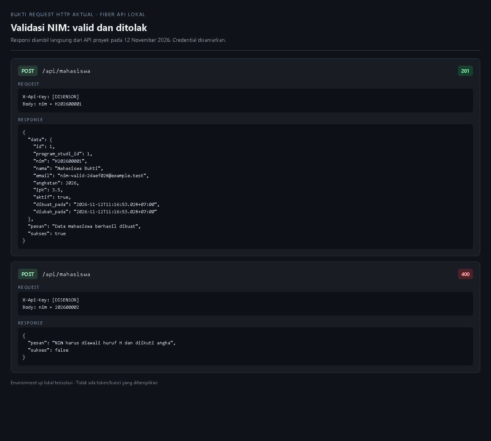
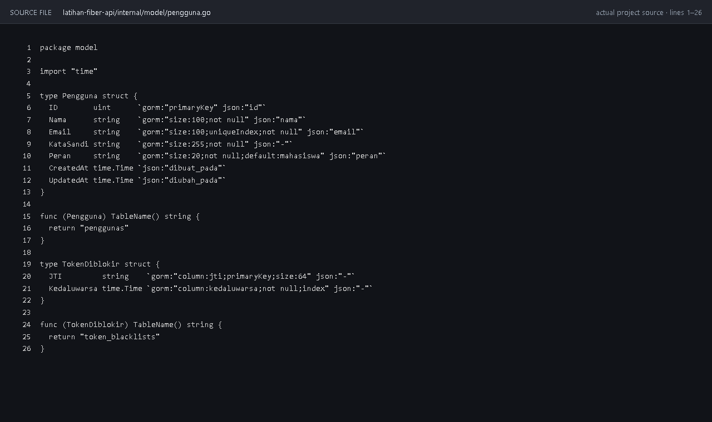
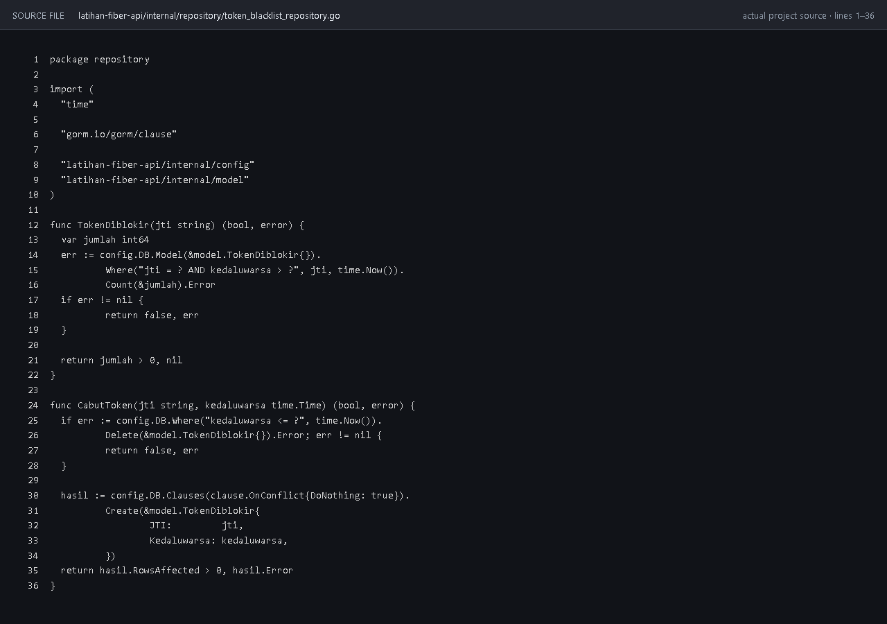
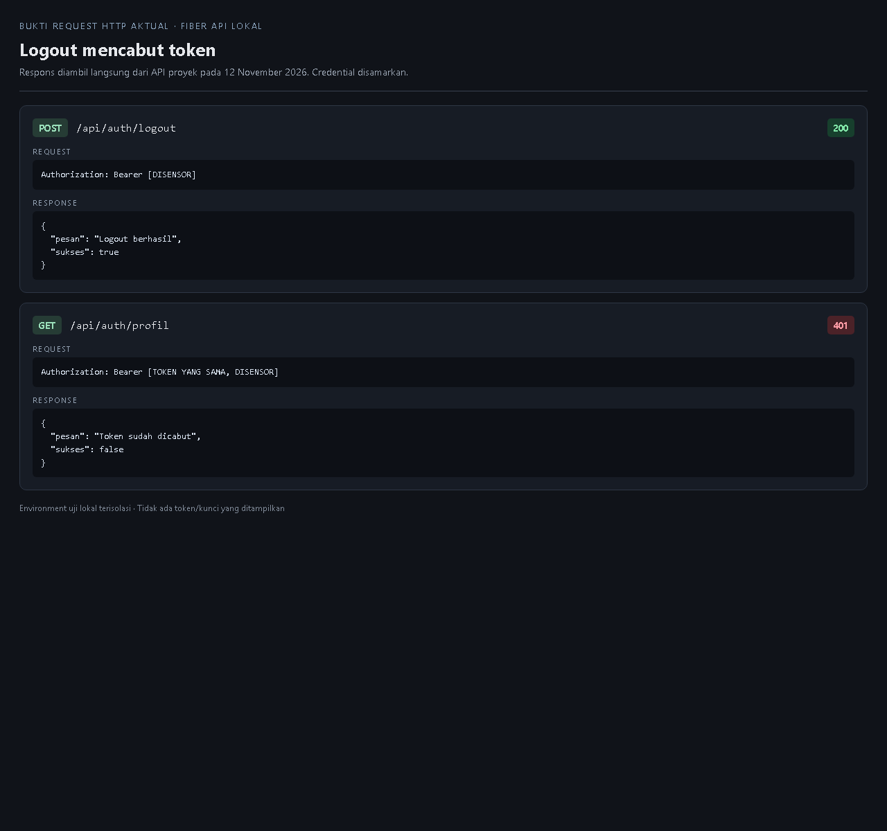

# E. Tugas Praktikum

### 1. Tambahkan endpoint `POST /api/auth/segarkan` yang menerbitkan token baru berdasarkan token yang masih berlaku.

  >Endpoint `POST /api/auth/segarkan` hanya menerima Bearer token yang valid dan belum dicabut. Middleware memeriksa signature, waktu kedaluwarsa, dan daftar hitam. Jika berhasil, server menerbitkan token baru sekaligus mencabut token lama agar token refresh tidak dapat digunakan berulang kali.
  >
  >Handler: [`auth_handler.go`](../latihan-fiber-api/internal/handler/auth_handler.go), fungsi `Segarkan` 
  >Route dan middleware: [`router.go`](../latihan-fiber-api/internal/router/router.go)

  >Screenshot route dan hasil request refresh sudah dilampirkan di bawah.

### 2. Tambahkan aturan validasi kustom untuk memastikan NIM diawali huruf H diikuti angka.

  >Aturan `nim` menggunakan pola `^H[0-9]+$`, sehingga NIM harus diawali huruf kapital `H` dan dilanjutkan satu atau lebih angka. Validasi diterapkan saat membuat maupun memperbarui data mahasiswa.
  >
  >Aturan kustom: [`validasi.go`](../latihan-fiber-api/internal/validasi/validasi.go) 
  >Penerapan pada permintaan mahasiswa: [`mahasiswa_handler.go`](../latihan-fiber-api/internal/handler/mahasiswa_handler.go)

  >Screenshot penerapan validasi dan hasil request NIM valid maupun tidak valid sudah dilampirkan di bawah.

### 3. Buat tabel daftar hitam token sederhana agar endpoint logout dapat mencabut token sebelum kedaluwarsa.

  >Tabel `token_blacklists` menyimpan JTI dan waktu kedaluwarsa token yang dicabut. Middleware memeriksa daftar ini pada setiap request terlindungi, sedangkan endpoint `POST /api/auth/logout` memasukkan token aktif ke daftar hitam. Data daftar hitam yang sudah kedaluwarsa dibersihkan saat token dicabut.
  >
  >Model: [`pengguna.go`](../latihan-fiber-api/internal/model/pengguna.go), tipe `TokenDiblokir` 
  >Repository: [`token_blacklist_repository.go`](../latihan-fiber-api/internal/repository/token_blacklist_repository.go) 
  >Handler dan route: [`auth_handler.go`](../latihan-fiber-api/internal/handler/auth_handler.go), [`router.go`](../latihan-fiber-api/internal/router/router.go) 
  >Pemeriksaan token: [`autentikasi.go`](../latihan-fiber-api/internal/middleware/autentikasi.go)

  >Screenshot model, repository, dan hasil logout dengan token yang dicabut sudah dilampirkan di bawah.

### 4. Buat analisis perbandingan implementasi autentikasi Modul 5 dan Modul 8.

  >Jumlah LOC menghitung baris kode yang tidak kosong dan bukan komentar. Cakupan Modul 5 meliputi controller autentikasi, middleware peran, model pengguna, migration terkait autentikasi, serta baris route dan konfigurasi middleware yang terkait. Cakupan Modul 8 meliputi handler autentikasi, utilitas JWT, middleware autentikasi, model dan repository blacklist, validasi, serta baris route, konfigurasi, migration, pemeriksaan secret, dan penerapan validasi NIM yang terkait. Tes dan kode framework yang tidak berhubungan dengan autentikasi tidak dihitung.
  >
  >| Modul | Implementasi | LOC |
  >|---|---|---:|
  >| Modul 5 | Laravel Sanctum | **189** |
  >| Modul 8 | Fiber, JWT, middleware, dan blacklist | **465** |

  >Pada cakupan tersebut, implementasi Modul 8 menggunakan 276 LOC lebih banyak (sekitar 2,46 kali). Modul 5 lebih ringkas dan mudah dibuat karena Laravel menyediakan validasi, hashing, model, serta Sanctum untuk penerbitan dan pencabutan token. Pada Modul 8, Fiber memberi kontrol langsung atas klaim JWT, secret, masa berlaku, middleware, respons galat, dan mekanisme pencabutan, tetapi lebih banyak bagian harus dirangkai dan diuji sendiri. Karena itu, Sanctum lebih mudah untuk aplikasi Laravel yang mengikuti pola framework, sedangkan implementasi Fiber lebih fleksibel untuk menyesuaikan format token dan aturan autentikasi. Angka LOC merupakan pengukuran berkas pada repositori ini, bukan ukuran umum kedua framework.

# F. Pertanyaan Pembahasan

### 1. Mengapa bcrypt lebih sesuai untuk kata sandi dibandingkan fungsi hash cepat seperti SHA-256?

  >bcrypt dirancang khusus untuk penyimpanan kata sandi: prosesnya sengaja lebih lambat dan memiliki salt, sehingga percobaan tebakan kata sandi secara massal menjadi lebih mahal. SHA-256 adalah hash umum yang sangat cepat; jika basis data hash bocor, penyerang dapat mencoba banyak tebakan per detik. bcrypt juga memiliki cost yang dapat dinaikkan mengikuti kemampuan perangkat keras.

### 2. Apa konsekuensi apabila nilai `JWT_SECRET` bocor?

  >Pihak yang memperoleh secret dapat membuat JWT dengan signature yang valid dan menyamar sebagai pengguna lain, termasuk memalsukan klaim seperti identitas atau peran. Token yang sudah diterbitkan juga tidak lagi dapat dipercaya sepenuhnya. Secret harus segera diganti dan token terdampak dicabut atau dibuat tidak berlaku; secret baru perlu disimpan aman dan tidak dimasukkan ke repositori.

### 3. Mengapa penerapan logout pada JWT memerlukan usaha tambahan dibandingkan token tersimpan?

  >JWT umumnya diverifikasi secara mandiri tanpa mencari catatan token di server. Karena itu, menghapus token dari sisi klien tidak membatalkan salinan token yang mungkin sudah dicuri dan token tetap berlaku sampai kedaluwarsa. Agar logout langsung berlaku, server perlu menyimpan identitas token yang dicabut, memeriksanya pada setiap request, dan membersihkan catatan yang sudah kedaluwarsa.

### 4. Jelaskan alasan pesan login gagal sebaiknya tidak menyebutkan apakah email atau kata sandi yang salah.

  >Pesan umum seperti “Email atau kata sandi tidak sesuai” mencegah penyerang mengetahui apakah sebuah email terdaftar. Jika aplikasi membedakan kedua kondisi, penyerang dapat mengumpulkan alamat email valid terlebih dahulu lalu menargetkan akun tersebut. Pesan yang seragam mengurangi risiko enumerasi akun.

## Konfigurasi dan Screenshot

Jalankan API dari folder `latihan-fiber-api`. Sebelum menjalankan, siapkan basis data MySQL dan isi `.env` dengan konfigurasi basis data serta `JWT_SECRET` acak minimal 32 byte. `JWT_TTL_MENIT` mengatur masa berlaku token. Jangan tampilkan secret, kata sandi, atau token penuh pada screenshot.

Untuk E.4 tidak diperlukan screenshot kode; tabel dan analisis perbandingan sudah dicantumkan di atas.

Screenshot kode menampilkan isi berkas proyek yang sebenarnya. Screenshot hasil API diambil dari request HTTP aktual ke server lokal; token dan kunci API disamarkan.