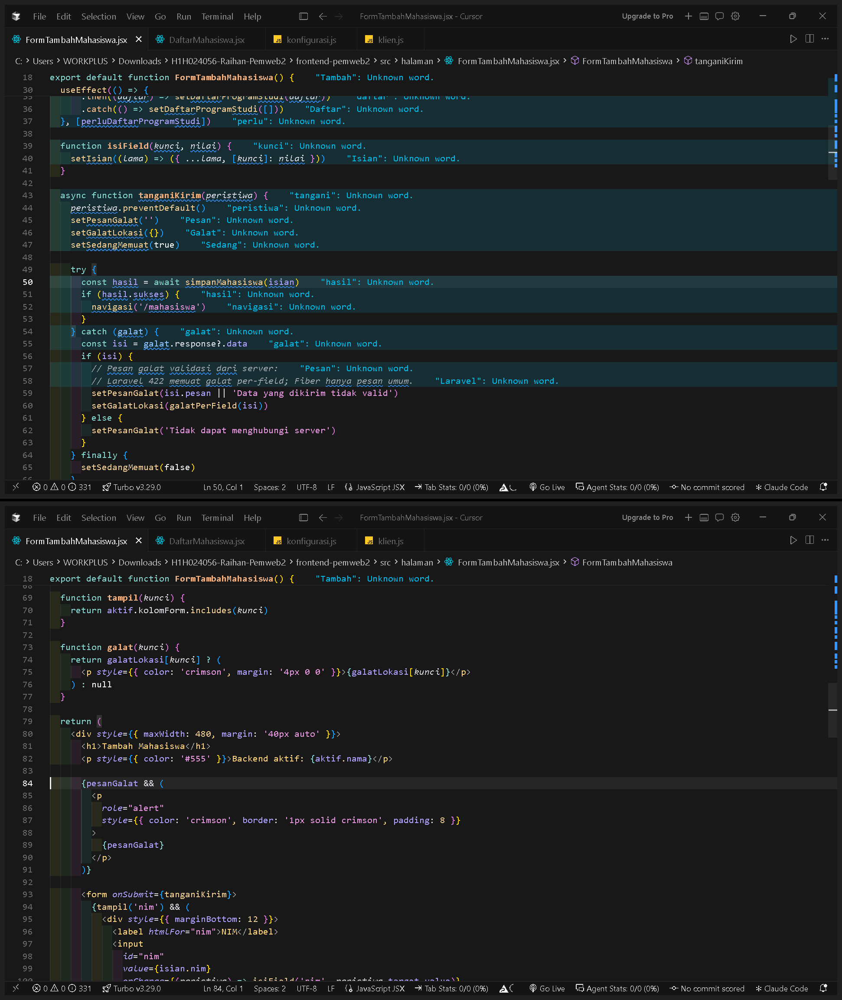
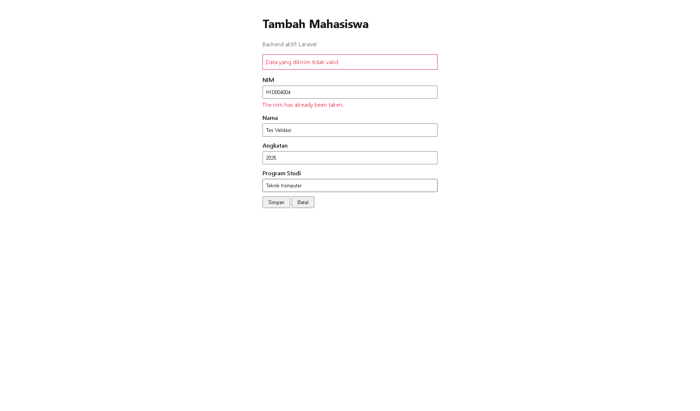
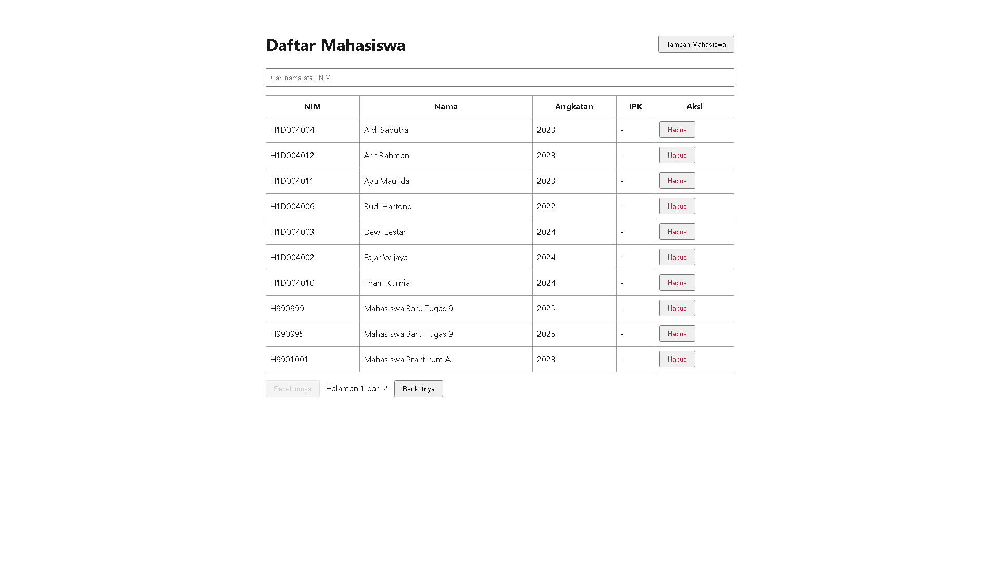
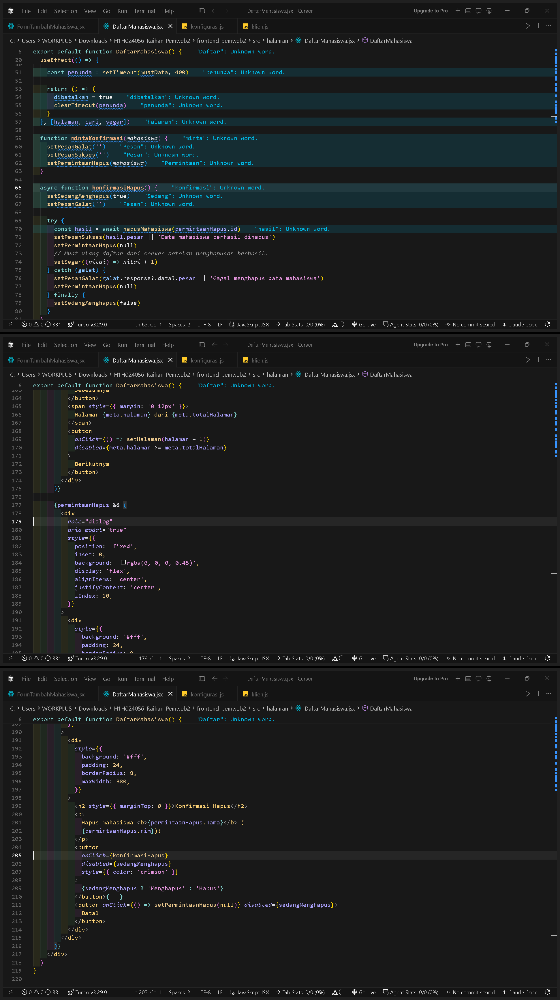
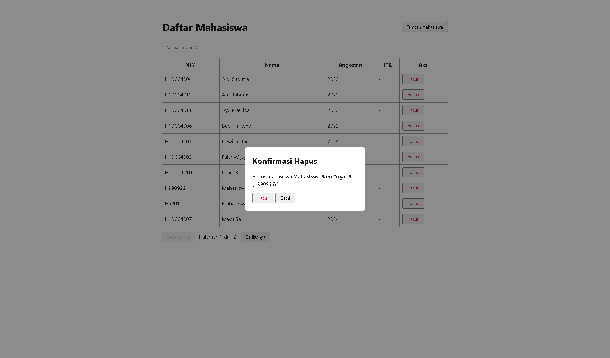
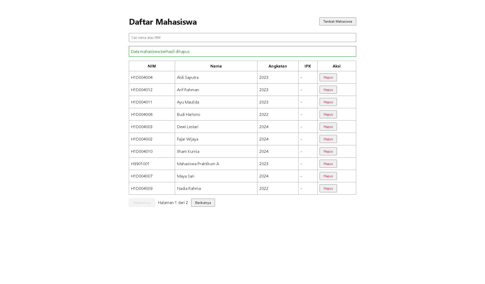
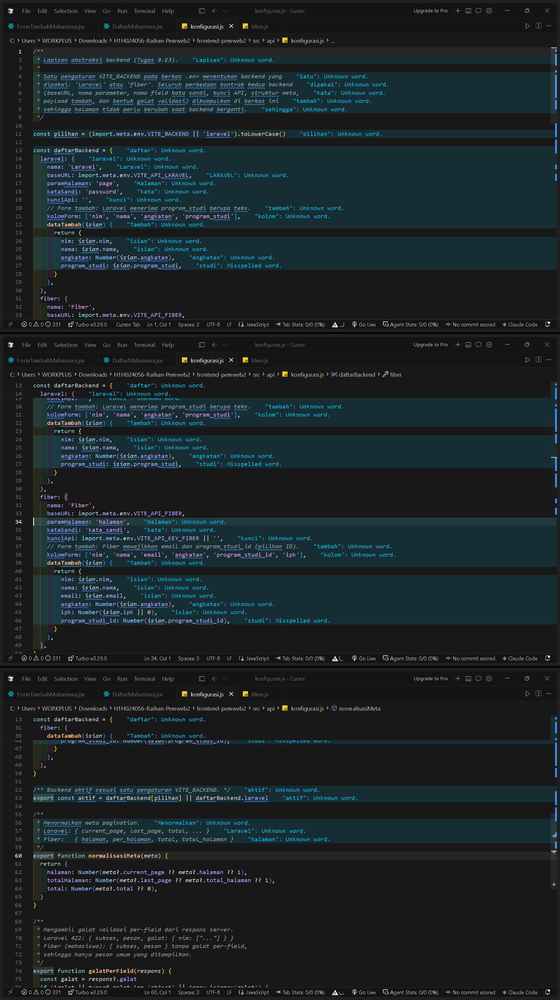
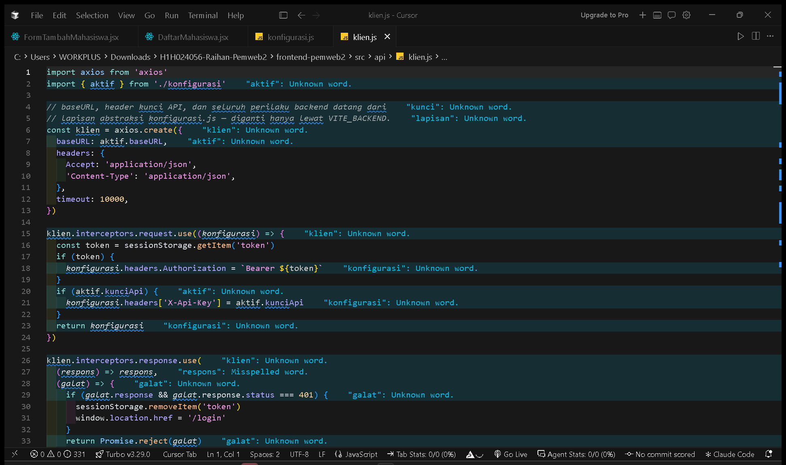
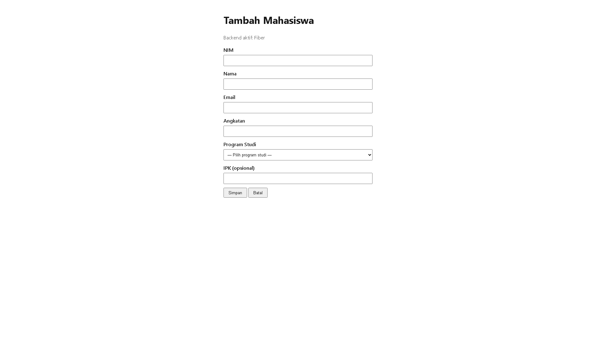

# E. Tugas Praktikum

### 1. Tambahkan halaman formulir tambah mahasiswa lengkap dengan penampilan pesan galat validasi dari server.

  >Halaman baru [`FormTambahMahasiswa.jsx`](../frontend-pemweb2/src/halaman/FormTambahMahasiswa.jsx) terdaftar pada rute `/mahasiswa/tambah` dan dapat dibuka lewat tombol **Tambah Mahasiswa** di halaman daftar. Field yang ditampilkan menyesuaikan backend aktif melalui `kolomForm` pada [`konfigurasi.js`](../frontend-pemweb2/src/api/konfigurasi.js): backend Laravel menerima NIM, nama, angkatan, dan program studi berupa teks; backend Fiber menambahkan email, pilihan program studi (berupa ID), serta IPK opsional karena mewajibkan ketiganya.

  >Penampilan pesan galat validasi dari server bekerja pada dua tingkat. Pesan umum `respons.data.pesan` selalu ditampilkan pada banner galat (baik 422 Laravel maupun 400 Fiber), sedangkan galat per-field dari `respons.data.galat` (respons 422 Laravel) ditempatkan tepat di bawah field terkait melalui helper `galatPerField`. Backend Fiber tidak mengirim galat per-field untuk pembuatan mahasiswa, sehingga pada backend tersebut hanya banner yang terisi. Kiriman yang gagal tidak mengosongkan isian form, sehingga pengguna dapat langsung memperbaiki data.
  >
  >Kirim data: [`layananMahasiswa.js`](../frontend-pemweb2/src/api/layananMahasiswa.js), fungsi `simpanMahasiswa` 
  >Bentuk payload per backend: [`konfigurasi.js`](../frontend-pemweb2/src/api/konfigurasi.js), fungsi `dataTambah`

### 2. Tambahkan tombol hapus dengan dialog konfirmasi serta pembaruan daftar setelah penghapusan berhasil.

  >Setiap baris pada [`DaftarMahasiswa.jsx`](../frontend-pemweb2/src/halaman/DaftarMahasiswa.jsx) memiliki tombol **Hapus** yang membuka dialog konfirmasi berupa lapisan modal (`role="dialog"`, `aria-modal`) tanpa pustaka tambahan. Dialog menampilkan nama dan NIM mahasiswa yang akan dihapus beserta tombol **Hapus** dan **Batal**; tombol dinonaktifkan selama proses berlangsung agar permintaan tidak terkirim dua kali.

  >Setelah konfirmasi, `hapusMahasiswa(id)` dijalankan dan pesan sukses dari `respons.data.pesan` ditampilkan. Pembaruan daftar dilakukan dengan menaikkan state `segar` yang menjadi ketergantungan `useEffect`, sehingga seluruh daftar dimuat ulang dari server — bukan sekadar menghapus baris secara lokal — sehingga pagination dan meta tetap akurat. Pilihan **Batal** menutup dialog tanpa mengirim permintaan apa pun.
  >
  >Konfirmasi dan muat ulang: [`DaftarMahasiswa.jsx`](../frontend-pemweb2/src/halaman/DaftarMahasiswa.jsx), fungsi `konfirmasiHapus` 
  >Permintaan hapus: [`layananMahasiswa.js`](../frontend-pemweb2/src/api/layananMahasiswa.js), fungsi `hapusMahasiswa` 
  >Pengiriman daftar (dipakai halaman daftar): `ambilDaftarMahasiswa` mengirim `halaman` dan `perHalaman` yang diterjemahkan oleh lapisan abstraksi menjadi `page`/`halaman` dan `per_page` sesuai backend aktif

### 3. Buat lapisan abstraksi sederhana agar aplikasi frontend dapat berpindah antara backend Laravel dan Fiber melalui satu pengaturan.

  >Satu pengaturan `VITE_BACKEND` (`laravel` atau `fiber`) pada berkas `.env` menentukan seluruh perilaku backend. Berkas [`konfigurasi.js`](../frontend-pemweb2/src/api/konfigurasi.js) mengumpulkan semua perbedaan kontrak kedua backend di satu tempat: `baseURL`, nama parameter halaman (`page` vs `halaman`), nama field kata sandi (`password` vs `kata_sandi`), header `X-Api-Key` untuk Fiber, daftar field form (`kolomForm`), payload tambah (`dataTambah`), normalisasi meta pagination (`normalisasiMeta`), dan ekstraksi galat per-field (`galatPerField`).

  >Berkas [`klien.js`](../frontend-pemweb2/src/api/klien.js) hanya membaca `aktif` dari konfigurasi untuk `baseURL`, interceptor menyisipkan `Authorization` serta `X-Api-Key` bila backend membutuhkannya, [`layananAuth.js`](../frontend-pemweb2/src/api/layananAuth.js) mengirim field kata sandi sesuai backend, dan halaman menggunakan `normalisasiMeta` sehingga label pagination seragam. Dengan demikian berpindah backend cukup mengubah satu baris pada `.env` lalu menjalankan ulang server pengembangan, tanpa menyentuh kode halaman.
  >
  >Pengaturan: berkas [`.env`](../frontend-pemweb2/.env) dan [`.env.example`](../frontend-pemweb2/.env.example) 
  >Klien HTTP: [`klien.js`](../frontend-pemweb2/src/api/klien.js)

### 4. Buat tabel perbandingan struktur respons kedua backend beserta usulan kontrak API tunggal yang dapat dipakai keduanya.

  >Perbandingan berikut ditulis berdasarkan kode sumber kedua backend pada repositori ini (controller Laravel dan handler Fiber), bukan dari asumsi format umum masing-masing framework.

  >| Aspek | Laravel (Modul 5) | Fiber (Modul 8) |
  >|---|---|---|
  >| Daftar mahasiswa | `{data, links, meta:{current_page, last_page, per_page, total}}` tanpa kunci `sukses` | `{sukses, data, meta:{halaman, per_halaman, total, total_halaman}}` |
  >| Parameter halaman | `page` | `halaman` |
  >| Isi satu baris | `id`, `nim`, `nama`, `angkatan`, `program_studi` (tanpa IPK/email) | `id`, `program_studi_id`, `nim`, `nama`, `email`, `angkatan`, `ipk`, `aktif`, timestamps |
  >| Simpan sukses (POST) | 201 `{sukses, pesan, data}` | 201 `{sukses, pesan, data}` (identik) |
  >| Galat validasi mahasiswa | 422 `{sukses, pesan, galat:{kunci:[...]}}` | 400 `{sukses, pesan}` tanpa galat per-field |
  >| Galat auth/izin/tidak ada | 401/403/404 `{sukses, pesan}` (render kustom `bootstrap/app.php`) | 401/403/404 `{sukses, pesan}` (`penanganGalat`) |
  >| Login | field `password` | field `kata_sandi` |
  >| Perlindungan khusus | Bearer token Sanctum + ability/peran pada tulis & hapus | Header `X-Api-Key` pada seluruh grup `/mahasiswa`; Bearer JWT pada `/auth/terproteksi` |

  >Perbedaan kunci `meta`, nama parameter halaman, field form, dan field kata sandi itulah yang semula memaksa penyesuaian kode halaman saat berpindah backend; seluruhnya kini dijembatani lapisan abstraksi pada butir E.3.

  >Usulan kontrak API tunggal yang dapat dipakai kedua backend:

  >| Jenis respons | Struktur bungkus | Status |
  >|---|---|---|
  >| Berhasil, ada data tunggal | `{ "sukses": true, "pesan": "...", "data": {...} }` | 200 / 201 |
  >| Berhasil, daftar + halaman | `{ "sukses": true, "data": [...], "meta": {"halaman": 1, "per_halaman": 10, "total": 50, "total_halaman": 5} }` | 200 |
  >| Galat validasi | `{ "sukses": false, "pesan": "Data yang dikirim tidak valid", "galat": {"nim": ["pesan per-field"]} }` | 422 |
  >| Galat lain (auth, izin, tidak ada, server) | `{ "sukses": false, "pesan": "..." }` | 401 / 403 / 404 / 500 |

  >Aturan pendukung kontrak: parameter daftar memakai `halaman`, `per_halaman`, dan `cari` di kedua backend; field kata sandi memakai `password` di kedua; pembuatan mahasiswa memakai `program_studi_id` sebagai relasi dan `program_studi` hanya sebagai tampilan hasil bentukan; galat validasi selalu 422 dan selalu menyertakan `galat` per-field; autentikasi cukup Bearer token sehingga seluruh endpoint memakai aturan header yang sama (syarat `X-Api-Key` dihapus atau diterapkan identik pada keduanya). Dengan kontrak ini frontend cukup satu jalur kode dan backend dapat ditukar tanpa perubahan halaman.

# F. Pertanyaan Pembahasan

### 1. Mengapa galat CORS tidak dapat diselesaikan dari sisi frontend?

  >CORS bukan fitur yang dikendalikan oleh kode JavaScript pada halaman, melainkan kebijakan same-origin yang ditegakkan peramban terhadap header respons server tujuan. Yang diperiksa peramban adalah `Access-Control-Allow-Origin`, `Access-Control-Allow-Methods`, dan `Access-Control-Allow-Headers` yang dikirim oleh server; frontend tidak dapat menambahkan atau memalsukan header tersebut atas nama server yang tidak mengizinkannya. Jika permintaan preflight `OPTIONS` tidak dijawab dengan benar, peramban memblokir permintaan utama sebelum dikirim meski endpoint sudah benar. Karena itu perbaikannya ada pada konfigurasi backend (`config/cors.php` pada Laravel dan middleware CORS pada Fiber). Menonaktifkan CORS melalui ekstensi peramban hanya menutupi gejala pada mesin tersebut: pengguna nyata tetap gagal, dan pengujian tidak lagi mewakili kondisi sebenarnya.

### 2. Jelaskan kelebihan dan kekurangan penyimpanan token pada sessionStorage dibandingkan cookie HttpOnly.

  >`sessionStorage` dapat dibaca JavaScript sehingga token mudah dilampirkan sebagai header `Authorization` pada setiap permintaan, tidak ikut terkirim otomatis sehingga risiko CSRF mengecil, dan mudah dihapus saat logout. Kelemahannya: skrip XSS dapat membaca dan mencurinya, token hilang ketika tab ditutup (pengguna harus masuk lagi), token tidak otomatis terkirim sehingga setiap permintaan harus menyertakan header secara manual, dan token tidak berbagi antar tab.

  >Cookie HttpOnly tidak dapat dibaca JavaScript sehingga XSS tidak bisa mengambil token secara langsung, dapat ditandai `Secure` dan `SameSite`, dan otomatis terkirim pada setiap permintaan. Kelemahannya: justru karena otomatis terkirim, ia berisiko CSRF sehingga membutuhkan proteksi tambahan (token CSRF atau `SameSite`), konfigurasinya lebih rumit lintas origin, dan kurang praktis bila API juga dipakai klien non-peramban. Untuk aplikasi web produksi, cookie HttpOnly + `Secure` + `SameSite` beserta token CSRF umumnya lebih aman; `sessionStorage` lebih sederhana untuk SPA/demo berbasis header Bearer.

### 3. Apa fungsi interceptor pada Axios dan masalah apa yang dicegah olehnya?

  >Interceptor adalah hook yang berjalan pada siklus setiap permintaan dan respons Axios secara terpusat. Interceptor permintaan menyisipkan `Authorization: Bearer <token>` (dan `X-Api-Key` bila diperlukan) sehingga mencegah token lupa dikirim atau penulisan kode pemasangan token yang terduplikasi di setiap halaman. Interceptor respons menangani status secara terpusat — pada kasus ini 401 menghapus token dan mengalihkan ke `/login` — sehingga mencegah pengguna terjebak pada halaman yang terus gagal karena token kedaluwarsa/tercabut, mencegah permintaan ulang tanpa henti dengan kredensial matif, dan menjaga penanganan galat tetap seragam antarhalaman. Interceptor juga merupakan tempat yang tepat untuk refresh token dan pesan galat global.

### 4. Mengapa penanganan status memuat dan galat penting bagi pengalaman pengguna?

  >Status memuat memberi umpan balik bahwa permintaan sedang diproses, sehingga pengguna tidak mengira aplikasi macet lalu mengklik berulang yang berujung pada kiriman ganda; tombol dapat dinonaktifkan selama proses dan penundaan (seperti debounce pencarian) menjadi jelas dengan pesan "Memuat data". Penanganan galat memberi tahu pengguna apa yang terjadi dan tindakan berikutnya — memperbaiki isian, masuk ulang, atau mencoba lagi — alih-alih menampilkan halaman kosong yang seolah berhasil. Tanpanya, kegagalan jaringan atau server terlihat seperti "data tidak ada", pengguna kehilangan kepercayaan, dan kesalahan tidak pernah dilaporkan. Kombinasi keduanya membuat aplikasi terasa responsif, dapat diprediksi, dan mudah dipulihkan saat terjadi masalah.

## Konfigurasi dan Screenshot

Jalankan tiga proses pada terminal terpisah: `php artisan serve` di folder `latihan-laravel` (port 8000), `go run ./cmd/api` di folder `latihan-fiber-api` (port 3000, memerlukan MySQL terisi beserta `API_KEY` dan `JWT_SECRET` pada `.env`), dan `npm run dev` di folder `frontend-pemweb2` (port 5173). Masuk dengan akun admin Modul 5 di `http://localhost:5173/login`.

CORS sudah dikonfigurasi pada kedua backend: `config/cors.php` Laravel (`allowed_origins` = `http://localhost:5173`) dan middleware `cors.New` pada [`main.go`](../latihan-fiber-api/cmd/api/main.go). Jika konfigurasi Laravel pernah di-cache, jalankan `php artisan config:clear`.

Berpindah backend dilakukan dari satu pengaturan: ubah `VITE_BACKEND` pada `frontend-pemweb2/.env` lalu hentikan dan jalankan ulang `npm run dev` (Vite membaca `.env` saat server start). Untuk backend fiber, isi `VITE_API_KEY_FIBER` dengan nilai `API_KEY` dari `latihan-fiber-api/.env`. Jangan tampilkan nilai API key, kata sandi, atau token penuh pada screenshot.

Daftar screenshot dan bagian tampilan yang harus diambil:

  >| Berkas | Bagian yang di-screenshot |
  >|---|---|
  >| `01-form-tambah-kode.png` | Editor membuka `frontend-pemweb2/src/halaman/FormTambahMahasiswa.jsx` — menampilkan fungsi `tanganiKirim` (pembacaan `galat.response.data` + `galatPerField`) dan blok render field |
  >| `02-form-tambah-galat.png` | Peramban `http://localhost:5173/mahasiswa/tambah` setelah submit form tidak valid (misal NIM kosong/duplikat) — banner galat merah dan pesan per-field terlihat |
  >| `03-form-tambah-sukses.png` | Peramban: submit form valid — halaman kembali ke daftar dan data baru muncul pada tabel |
  >| `04-hapus-dialog-kode.png` | Editor `frontend-pemweb2/src/halaman/DaftarMahasiswa.jsx` — fungsi `konfirmasiHapus` dan JSX blok dialog (`role="dialog"`) |
  >| `05-dialog-hapus.png` | Peramban: klik tombol **Hapus** pada salah satu baris — dialog konfirmasi tampil di atas daftar |
  >| `06-hapus-setelah-daftar.png` | Peramban: setelah klik **Hapus** pada dialog — pesan hijau "Data mahasiswa berhasil dihapus" tampil dan baris sudah hilang dari daftar |
  >| `07-abstraksi-konfigurasi.png` | Editor `frontend-pemweb2/src/api/konfigurasi.js` — blok `daftarBackend` (laravel & fiber) beserta `normalisasiMeta` |
  >| `08-klien-axios.png` | Editor `frontend-pemweb2/src/api/klien.js` — pembuatan instance Axios dengan `baseURL` dari konfigurasi dan interceptor request/response |
  >| `09-pindah-backend-fiber.png` | Peramban `http://localhost:5173/mahasiswa/tambah` setelah `VITE_BACKEND=fiber` dan server dev dijalankan ulang — label "Backend aktif: Fiber" dan dropdown program studi terlihat |
  >| E.4 | Tidak perlu screenshot — tabel perbandingan dan usulan kontrak sudah dicantumkan di atas |

Screenshot kode menampilkan isi berkas proyek yang sebenarnya. Screenshot hasil diambil dari aplikasi yang berjalan pada server lokal.
